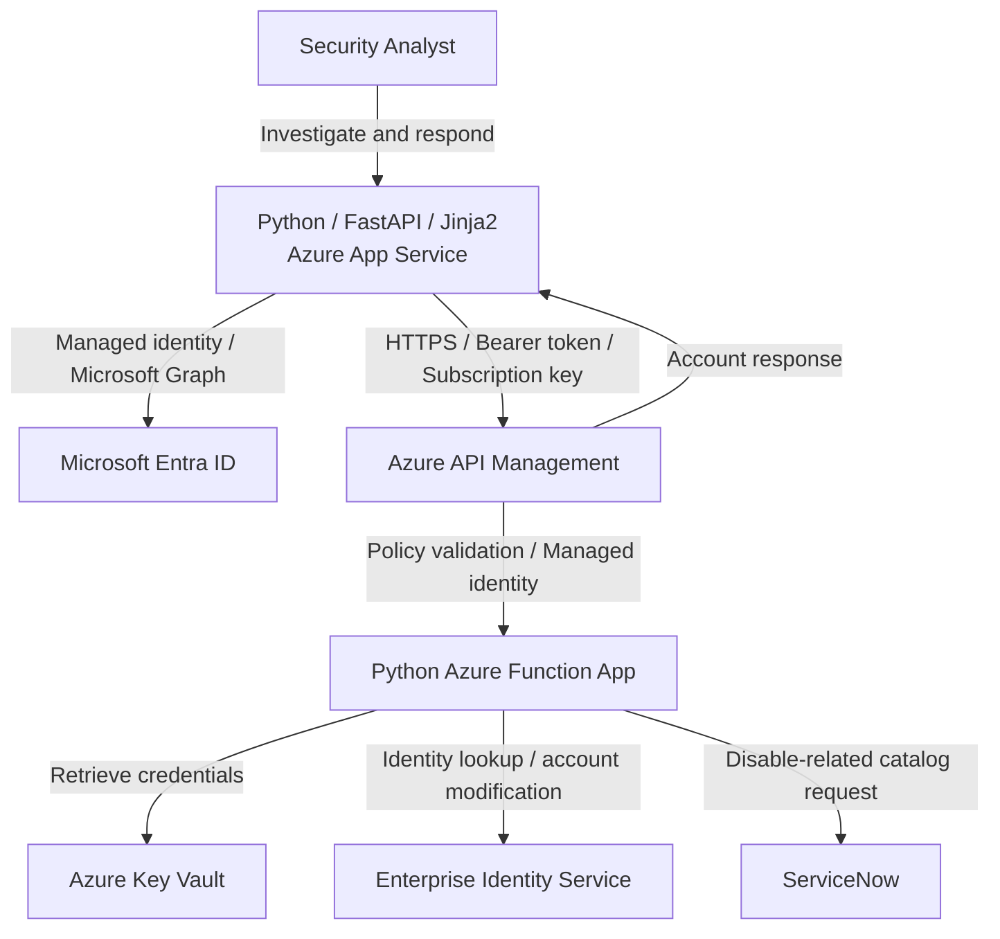
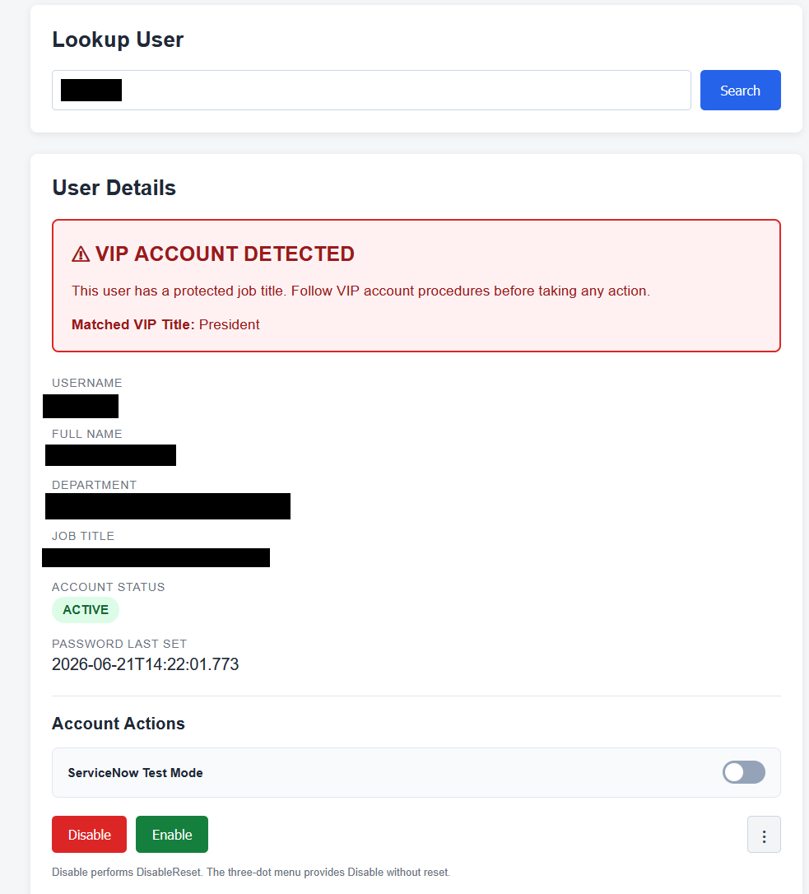
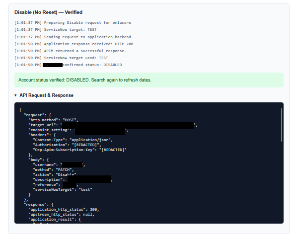

# Azure Identity Security Response Platform


**A production Python-based identity security and incident response platform integrating Azure App Service, Azure API Management, Azure Functions, Microsoft Entra ID, and ServiceNow.**

Developed for security operations within a large enterprise, the platform unifies identity investigation, directory enrichment, VIP-aware account protections, automated remediation, and outcome verification in a single analyst interface. Its architecture connects a custom Python application to enterprise identity infrastructure through managed identities, a policy-controlled API gateway, and Python-based serverless execution.

## Platform Capabilities

| Capability | Implementation |
| --- | --- |
| **Centralized identity investigation** | Account lookup by username or email, authoritative account status, and relevant account timestamps |
| **Directory intelligence** | Microsoft Graph enrichment with Microsoft Entra ID display name, department, and job title |
| **Account remediation** | Enable, disable with reset, and disable without reset operations |
| **Protected-account safeguards** | Configurable VIP detection with server-side revalidation and blocking of protected disable operations |
| **Enterprise workflow integration** | Azure Functions execution, Azure Key Vault credential retrieval, and ServiceNow catalog activity |
| **Response assurance** | Follow-up account-state verification, live execution feedback, and expandable API diagnostics |

## Enterprise Architecture

The platform separates the analyst experience, application business logic, directory enrichment, API policy enforcement, serverless function execution, and downstream account management. Python coordinates these services without placing identity-service credentials or Function App endpoints in the browser.



**Python / FastAPI — Application and control layer.** The Azure App Service application implements identity resolution, Microsoft Graph integration, request validation, VIP safeguards, account-action orchestration, result interpretation, and state verification. Jinja2 and JavaScript provide the analyst-facing experience.

**Microsoft Entra ID — Organizational identity context.** Microsoft Graph supplies directory attributes associated with the canonical enterprise account, allowing the application to present organizational context and evaluate protected job titles.

**Azure API Management — Governed integration boundary.** APIM mediates application requests, applies gateway validation and subscription requirements, and authenticates to the downstream Function App with managed identity. APIM's broader architecture and policy design are documented separately.

**Azure Functions — Serverless execution.** Python HTTP-triggered functions validate incoming requests, retrieve credentials from Key Vault using managed identity, call the enterprise identity API, and return structured responses. For supported disable operations, the function also submits the associated ServiceNow catalog request.

**Enterprise identity service and ServiceNow — Operational systems.** The identity service supplies authoritative account state and performs account modifications. ServiceNow receives catalog activity associated with supported disable operations.

---

## Python Application Engineering

The application is built with **Python and FastAPI**, with separate modules for APIM communication and Microsoft Graph queries. Rather than delegating all decisions to the downstream function, the Python backend owns the account investigation flow, business-rule enforcement, action dispatch, and post-action verification.

The backend resolves a canonical account identifier before performing Entra enrichment, validates account-action requests on the server, and independently checks VIP status before sensitive disable actions. Its HTTP integration layer obtains managed-identity tokens and submits JSON requests to configured APIM endpoints; responses are evaluated before the interface reports an operation as verified.

The frontend uses **Jinja2, HTML, CSS, and JavaScript** to present account details, status indicators, protected-account warnings, action controls, live progress, and detailed API diagnostics.

<details>
<summary><strong>Python — Managed-identity API integration</strong></summary>

The following excerpt illustrates the application-to-APIM request pattern, with environment-specific values omitted.

```python
from azure.identity import ManagedIdentityCredential
import requests

credential = ManagedIdentityCredential()

def call_identity_api(url, payload, scope, subscription_key):
    token = credential.get_token(scope).token
    response = requests.post(
        url,
        json=payload,
        headers={
            "Authorization": f"Bearer {token}",
            "Ocp-Apim-Subscription-Key": subscription_key,
            "Content-Type": "application/json",
        },
        timeout=60,
    )
    response.raise_for_status()
    return response.json()
```

The public example illustrates the authentication and transport pattern; the application implementation also handles response diagnostics and error propagation.

</details>

<details>
<summary><strong>Python — Canonical identity lookup</strong></summary>

```python
result, debug = get_user_status(
    username,
    include_debug=DEBUG_UI,
)

canonical_username = normalize_eraider_result(result)
entra_user = get_entra_user(canonical_username)

user = {
    "username": canonical_username,
    "display_name": entra_user.get("display_name"),
    "department": entra_user.get("department"),
    "job_title": entra_user.get("job_title"),
    "status": str(result.get("status") or "UNKNOWN").upper(),
}
```

The canonical identity returned by the authoritative account system is reused for directory enrichment and account actions, even when the initial search uses an email address.

</details>

## Identity Investigation and Directory Enrichment

A search first resolves the account through the enterprise identity service, then uses its canonical username for Microsoft Graph correlation. The resulting view combines current account status and timestamps with directory data such as display name, department, and job title.

This joins identity data maintained by separate enterprise systems into one operational view, placing the account's technical state and organizational context alongside the actions available to the analyst.

### Account Lookup and VIP Identification

<p align="center">
  
</p>

### VIP-Aware Security Controls

Protected job titles are defined through application configuration and evaluated using case-insensitive matching against Entra ID job-title data. Accounts matching a protected title receive a prominent VIP warning; missing job-title information is treated as an unverified classification.

The safeguard is enforced **in the Python backend**, not solely through the interface. Immediately before a disable operation, the application resolves the account again, retrieves directory information, and reevaluates VIP classification. Both disable variants require an explicitly non-VIP result before the request can proceed to APIM.

<details>
<summary><strong>Python — Server-side VIP enforcement</strong></summary>

```python
if action in ("disable_reset", "disable_no_reset"):
    if vip["is_vip"] is not False:
        return action_response(
            "Disable blocked: VIP account detected "
            "or VIP status could not be verified.",
            403,
        )
```

The VIP assessment is repeated immediately before the account action, independent of the classification already rendered in the analyst's browser.

</details>

---

## Automated Identity Remediation

Analysts can perform three account-management operations from the same interface:

| Operation | Workflow action | Verified account state |
| --- | --- | --- |
| **Enable account** | `Enable` | `ACTIVE` |
| **Disable with reset** | `DisableReset` | `DISABLED` |
| **Disable without reset** | `Disable` | `DISABLED` |

The Python backend builds a structured request and sends it to APIM over HTTPS. The gateway applies its policies and forwards the request to the Python Azure Function, which validates the payload and executes the requested downstream identity operation.

The application-to-APIM request uses **HTTP POST**, while the JSON `method` property identifies the downstream **`PATCH`** account modification. This distinction is preserved across the application, API gateway, and Function App integration.

<details>
<summary><strong>API — Account-action request</strong></summary>

```json
{
  "username": "example.user",
  "method": "PATCH",
  "action": "DisableReset",
  "description": "Identity security response",
  "reference": "Identity Response Platform",
  "serviceNowTarget": "production"
}
```

The available `action` values are `Enable`, `DisableReset`, and `Disable`; the ServiceNow target is independently selected as `production` or `test`.

</details>

### Account Remediation and Verification

<p align="center">
  
</p>

Following a successful API response, the Python application performs a new identity lookup and compares the returned state with the expected result. An HTTP acknowledgment and a verified account change are represented separately, making the authoritative account state the basis of the completion indicator.

<details>
<summary><strong>Python — Post-action state verification</strong></summary>

```python
latest, _ = get_user_status(canonical_username)
observed_status = str(
    latest.get("status") or "UNKNOWN"
).upper()

expected_status = action_config["expected_status"]
verified = observed_status == expected_status
```

The interface reflects whether the resulting state has been confirmed by the identity service.

</details>

## Azure Functions and ServiceNow Integration

**Azure Functions** provides the downstream execution layer for account investigation and remediation. An HTTP-triggered Python function validates the request, retrieves required secrets from **Azure Key Vault**, and queries the authoritative identity backend. For account modifications, the function performs the requested PATCH operation and returns the resulting response. Successful supported disable operations additionally trigger a ServiceNow catalog request. The integration reports errors with stage identifiers and diagnostic IDs, including partial-success information when the identity change succeeds but ServiceNow activity fails.

The interface exposes a **ServiceNow Test Mode** control to select the service-management destination. This setting changes where the associated ServiceNow activity is directed; it does not change or simulate the underlying identity modification. The separation allows the same identity-response pathway to interact with the appropriate ServiceNow environment.

This serverless integration connects a custom Python application with established enterprise identity and IT service-management systems while keeping downstream credentials outside the application source and frontend.

---

## Security Architecture

Security controls are applied at multiple boundaries: the browser-to-application request, the application-to-APIM integration, the gateway-to-Function-App call, and the function's access to downstream systems.

| Area | Engineering implementation |
| --- | --- |
| **Managed identity** | Azure-managed service identities authenticate the Python application to Microsoft Graph and APIM, and APIM to the Function App backend. |
| **API policy enforcement** | APIM applies caller validation, subscription requirements, policy-driven routing, and backend authentication. |
| **Credential protection** | The Python Function App retrieves backend credentials from Azure Key Vault using its managed identity instead of embedding them in source code. |
| **VIP protection** | Sensitive disable actions require a fresh, explicitly non-VIP assessment in the Python backend. |
| **Request protection** | Account-action requests use CSRF validation; supported actions and ServiceNow targets are server-validated. |
| **Configuration separation** | Endpoints and security-relevant application settings are externally configured. |
| **Diagnostics** | Request inspection redacts bearer tokens and subscription keys. |
| **Outcome verification** | A follow-up authoritative lookup checks the resulting account status. |

The combination of application-level controls, managed identities, API governance, and downstream workflow isolation supports controlled execution of privileged identity operations across multiple enterprise services.

## Operational Visibility

The analyst interface includes action progress, execution results, and an expandable **API Request & Response** view. It displays the application-to-APIM HTTP method, sanitized target endpoint, selected action, JSON body, and returned status and response data.

### Request and Response Diagnostics

<p align="center">
  
</p>

The diagnostics expose the relevant application integration details while redacting authentication headers. Together with the post-action account lookup, they make it possible to distinguish an API response from a confirmed change in the enterprise identity system.

<details>
<summary><strong>Python — Redacted request diagnostics</strong></summary>

```python
request_details = {
    "http_method": "POST",
    "target_url": safe_url,
    "endpoint_setting": action_config["url_setting"],
    "headers": {
        "Content-Type": "application/json",
        "Authorization": "[REDACTED]",
        "Ocp-Apim-Subscription-Key": "[REDACTED]",
    },
    "body": payload.copy(),
}
```

The diagnostic capture documents the outbound Python application request without displaying bearer tokens or APIM subscription secrets.

</details>

---

## Engineering Highlights

**Custom application development.** A production Python/FastAPI application provides a tailored security operations interface, integrates with external services, enforces business rules, and tracks account action outcomes.

**Cross-system identity correlation.** Authoritative account lookup and Microsoft Entra ID enrichment are joined through canonical identity resolution to provide consistent context across systems.

**Layered Azure integration.** App Service, API Management, managed identities, Azure Functions, and Key Vault each serve a distinct responsibility in the request and execution path.

**Privileged workflow safeguards.** VIP status is revalidated server-side before disable operations, while account actions are constrained to supported operations and verified against the authoritative backend afterward.

**Enterprise service-management integration.** Function-based remediation coordinates downstream ServiceNow activity alongside identity changes, with separately selectable production and test ticketing targets.

**Operationally meaningful results.** The interface combines immediate execution feedback with independent account-state verification and inspectable API transactions.

---

**Technology stack:** Python · FastAPI · Jinja2 · JavaScript · Azure App Service · Azure API Management · Azure Functions · Azure Managed Identity · Microsoft Graph · Microsoft Entra ID · Azure Key Vault · ServiceNow
