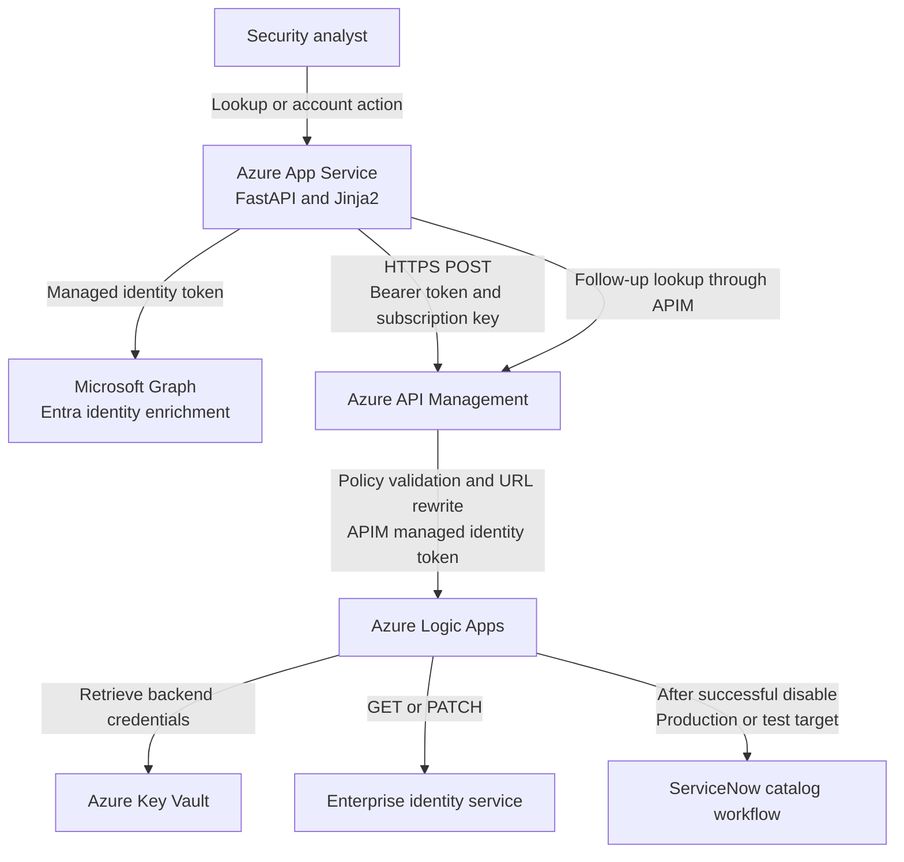

# Azure Identity Security Response Platform


![Azure Logic Apps](https://img.shields.io/badge/%20%20Azure%20Logic%20Apps-0078D4?style=flat&logo=data:image/svg%2bxml;base64,PHN2ZyB4bWxucz0iaHR0cDovL3d3dy53My5vcmcvMjAwMC9zdmciIHZpZXdCb3g9IjAgMCAxOCAxOCI+PHBhdGggZD0iTTEzLjg1MSw5LjA0N0gxMC45MzlBMS41MTgsMS41MTgsMCwwLDEsOS40MjEsNy41Mjl2LTMuMkg4LjU3OXYzLjJBMS41MTgsMS41MTgsMCwwLDEsNy4wNjEsOS4wNDdINC4xNDlhMS4yLDEuMiwwLDAsMC0xLjIsMS4ydjIuMzM4aC44NDFWMTAuMjQ0YS4zNTUuMzU1LDAsMCwxLC4zNTYtLjM1NUg3LjA2MUEyLjM1MywyLjM1MywwLDAsMCw4LjgsOS4xMjVhLjI3OC4yNzgsMCwwLDEsLjQwOCwwLDIuMzUzLDIuMzUzLDAsMCwwLDEuNzM1Ljc2NGgyLjkxNmEuMzU4LjM1NCwwLDAsMSwuMzU1LjM1NXYyLjMzOGguODQxVjEwLjI0NEExLjIsMS4yLDAsMCwwLDEzLjg1MSw5LjA0N1oiIGZpbGw9IiNmZmZmZmYiLz48cmVjdCB4PSI1LjYyNiIgeT0iLTAuMDIiIHdpZHRoPSI2Ljc0NyIgaGVpZ2h0PSI2Ljc0NyIgcng9IjAuNjA0IiBmaWxsPSIjZmZmZmZmIi8+PHJlY3QgeT0iMTEuMjczIiB3aWR0aD0iNi43NDciIGhlaWdodD0iNi43NDciIHJ4PSIwLjYwNCIgZmlsbD0iI2ZmZmZmZiIvPjxyZWN0IHg9IjExLjI1MyIgeT0iMTEuMjczIiB3aWR0aD0iNi43NDciIGhlaWdodD0iNi43NDciIHJ4PSIwLjYwNCIgdHJhbnNmb3JtPSJ0cmFuc2xhdGUoMjkuMjczIDAuMDIpIHJvdGF0ZSg5MCkiIGZpbGw9IiNmZmZmZmYiLz48L3N2Zz4=)


Enterprise identity security and incident response through Azure-hosted automation, Microsoft Entra ID enrichment, and a centralized analyst interface.

The platform connects account investigation with controlled remediation. Analysts can resolve an enterprise identity, review its account state and organizational context, identify protected accounts, initiate supported account actions, and verify the resulting state from the identity system.

---

## Overview

Identity response spans several systems: the authoritative account service, directory attributes, automation workflows, and service-management processes. Performing those steps independently makes it harder to apply consistent safeguards and distinguish a successful request from a completed account change.

This platform brings those steps into one workflow while keeping their responsibilities separate. The enterprise identity service supplies account state, Microsoft Entra ID supplies directory context, and Azure-hosted automation performs the account operation and applicable ServiceNow activity.

The web application supports:

- Account lookup by username or email through the identity service.
- Account status, password-last-set information, and applicable disable timestamps.
- Display name, department, and job-title enrichment from Microsoft Graph.
- Configurable VIP classification and server-side blocking of protected or unverified disable requests.
- Enable, disable with reset, and disable without reset operations.
- ServiceNow production or test routing.
- Follow-up account-state verification and expandable request/response diagnostics.

## Architecture



| Component | Responsibility |
| --- | --- |
| Azure App Service | Hosts the analyst interface and Python application. |
| FastAPI and Jinja2 | Handle lookup, server-side safeguards, account-action submission, and result presentation. |
| Microsoft Graph / Entra ID | Enrich the resolved account with display name, department, and job title. |
| Azure API Management | Provides the application-facing API boundary, caller validation, subscription requirements, and backend routing. |
| Azure Logic Apps | Orchestrates identity-service calls, credential retrieval, response handling, and ServiceNow routing. |
| Azure Key Vault | Supplies identity-service and ServiceNow credentials to the workflow. |
| Enterprise identity service | Resolves the canonical username and performs authoritative account operations. |
| ServiceNow | Receives catalog requests associated with successful disable actions. |

APIM is a supporting component here and will receive a separate, dedicated writeup. This repository retains the integration details needed to understand the platform without reproducing the full gateway configuration.

<!-- Future screenshot: /imgs/platform-overview.png -->

---

## Account Investigation and Response

### 1. Resolve the authoritative identity

The application submits the analyst's username or email to the identity lookup endpoint through APIM. It requires a nonempty canonical username in the returned account data before continuing.

This resolution step matters because the directory enrichment and subsequent account operation should refer to the same identity, even when the initial search used an email address.

<details>
<summary><strong>View the lookup request</strong></summary>

From `web-app/identity_apim.py`:

```python
return call_identity_api(
    os.environ["IDENTITY_APIM_GET_URL"],
    {
        "username": username,
        "method": "GET",
    },
    include_debug=include_debug,
    http_method="POST",
)
```

The HTTP request to APIM is POST. The JSON `method` field selects the logical operation performed downstream.

</details>

### 2. Enrich the account with Entra ID context

The application obtains a Microsoft Graph token using its App Service managed identity. It searches for the canonical username using `onPremisesSamAccountName`, requests the identity attributes needed by the interface, and requires exactly one matching directory user.

Display name, department, and job title are combined with the identity service's account status and timestamps. Missing or ambiguous directory results produce an error instead of silently attaching another user's attributes.

The source contains no embedded Graph client secret. Managed identity authenticates the application; the actual Graph permission assignments are external to this repository.

### 3. Classify and protect VIP accounts

Protected job titles come from the `IDENTITY_VIP_TITLES` environment variable as a nonempty JSON list. Classification uses case-insensitive substring matching, so a configured title can match a longer job-title value.

A match produces a VIP warning. A missing or empty job title produces an unverified classification. Before either disable operation, the backend independently resolves the account again, retrieves directory attributes, and reevaluates the classification.

<details>
<summary><strong>View the server-side disable safeguard</strong></summary>

From `web-app/main.py`:

```python
if action in (
    "disable_reset",
    "disable_no_reset",
):
    if vip["is_vip"] is not False:
        return action_response(
            "Disable blocked: VIP account "
            "detected or VIP status could "
            "not be verified. Follow the "
            "VIP handling procedure.",
            403,
        )
```

The browser's displayed classification is not trusted as the authorization for a disable request. Lookup failures or invalid title configuration also prevent the action from reaching APIM.

This implementation provides classification, warnings, and blocking. It does not implement a VIP approval workflow or an override path.

</details>

<!-- Future screenshot: /imgs/vip-safeguard.png -->

### 4. Submit a controlled account action

The backend verifies the CSRF token, validates the username, restricts actions to the supported set, and accepts only `production` or `test` as the ServiceNow target. It selects the APIM URL from server-side configuration.

| Analyst action | JSON action | JSON method | Expected account state |
| --- | --- | --- | --- |
| Enable | `Enable` | `PATCH` | `ACTIVE` |
| Disable with reset | `DisableReset` | `PATCH` | `DISABLED` |
| Disable without reset | `Disable` | `PATCH` | `DISABLED` |

All three application-to-APIM requests use **HTTP POST**, even though their JSON `method` value is `PATCH`. APIM forwards a POST to the Logic App request trigger; the workflow uses the JSON method when calling the identity service.

<details>
<summary><strong>View a sanitized account-action payload</strong></summary>

```json
{
  "username": "example.user",
  "method": "PATCH",
  "action": "DisableReset",
  "description": "Identity security response",
  "reference": "Identity Response Platform",
  "serviceNowTarget": "production"
}
```

The action names describe the downstream identity-service contract. The implementation of the reset operation itself is outside this repository.

</details>

### 5. Execute the workflow and route ServiceNow activity

The Logic App retrieves the identity-service credential from Key Vault, branches on the requested method, and forwards lookup or modification requests to the identity service. It validates supported account actions and returns workflow responses to the caller.

For a modification returning HTTP 200, the workflow distinguishes disable actions from enable actions. Disable actions retrieve the ServiceNow credential and submit a catalog request to the selected environment. Enable actions return the identity-service response without creating that catalog request. Other identity-service status codes are passed back through a separate response branch.

> [!IMPORTANT]
> **ServiceNow Test Mode changes only the ServiceNow target.** It does not simulate, suppress, or roll back the identity-service operation. Account enable and disable requests still execute against the configured identity backend.

Identity changes occur before the ServiceNow request. A later ticketing failure therefore does not prove that the account change failed. The workflow has no cross-service transaction or rollback; analysts must check account state before retrying an uncertain result.

### 6. Verify the resulting account state

After a successful action response, the application checks for supported business-error indicators and performs a fresh account lookup through APIM. It compares the observed status with the expected state for that action.

```python
observed_status = str(
    latest.get("status") or "UNKNOWN"
).upper()
expected = action_config["expected_status"]
verified = observed_status == expected
```

The interface distinguishes a successful API response from a verified account state. A mismatched state or failed follow-up lookup is presented as unconfirmed, while API and recognized backend failures are presented as errors.

Verification is a single follow-up lookup, not a polling loop. A delayed backend update may require another lookup. Verification confirms the account status; it does not independently prove password-reset completion or downstream ticket fulfillment.

<!-- Future screenshot: /imgs/action-verification.png -->

---

## Security Engineering Decisions

| Control | Implementation and boundary |
| --- | --- |
| Managed identity | The application uses `ManagedIdentityCredential` for Graph and APIM tokens. APIM policy excerpts obtain a separate managed-identity token for the workflow backend. |
| Gateway caller validation | The retained product policy requires a configured caller object ID; its validation fragment checks the Entra tenant and token audience. |
| Subscription-key requirement | The application sends an APIM subscription key in addition to its bearer token. The relevant API/product excerpts require a subscription. |
| Server-side VIP safeguard | Both disable actions require a freshly evaluated, explicitly non-VIP result. |
| CSRF protection | Account modifications require a matching cookie/header token; the cookie uses the `__Host-` prefix, Secure, HttpOnly, and SameSite Strict attributes. |
| Input restrictions | Supported actions and ServiceNow targets are allowlisted on the server. |
| Configuration separation | APIM URLs, scope, subscription key, protected-title configuration, and lookup-debug setting are read from environment variables. |
| Credential handling | Workflow credentials come from Key Vault. Secret-fetch actions mark inputs and outputs as secure data. |
| Diagnostic redaction | Constructed request details replace bearer-token and subscription-key values with redaction markers and omit URL query strings. |
| Outcome verification | A fresh identity-service lookup checks the expected account status after a successful action response. |

Managed identity authenticates services; it does not establish which human analyst may use the web interface. The included FastAPI routes do not implement operator sign-in or role authorization. App Service authentication settings, Graph permissions, and a complete workflow-trigger access policy are not included, so this writeup does not claim to demonstrate those controls.

The code includes operational logging, but it does not demonstrate a complete, attributable analyst audit trail. VIP matching depends on directory data and configured title substrings; it is not a general-purpose authorization system.

## Diagnostics and Troubleshooting

The interface provides expandable details for the application-to-APIM request, including the HTTP method, target URL, payload, and returned result. Lookup diagnostics are controlled by `IDENTITY_DEBUG_UI`; account-action diagnostics are returned independently of that setting.

Lookup diagnostics include the upstream status and elapsed time. Action diagnostics include the application response status and an upstream status when an HTTP error is available. They do not expose APIM's internally rewritten request to the Logic App; investigating that hop requires separate gateway tracing.

Redaction applies to the constructed authentication fields and URL query strings. Account payloads, backend response bodies, and some logged errors can still contain identity data. These are operational diagnostics, not an automatic sanitizer for screenshots or exported logs.

<!-- Future screenshot: /imgs/request-diagnostics.png -->

## Engineering Challenges and Operational Value

**Joining identities across systems.** Resolving the canonical username before directory enrichment reduces the chance that an analyst's input is interpreted differently by the account service and Entra ID. Rejecting zero or multiple directory matches keeps uncertainty visible.

**Separating transport from operation semantics.** POST is the application-facing transport, while the payload chooses GET or PATCH for the authoritative identity service. Preserving that distinction across the application, gateway, and workflow prevents ambiguous routing and misleading diagnostics.

**Keeping safeguards on the server.** Rechecking VIP status immediately before a disable request prevents a stale page or modified browser request from bypassing the application safeguard.

**Handling partial completion.** Identity changes and ServiceNow requests are separate operations. The UI separates acceptance, verified state, and uncertainty so an analyst has a reason to investigate before submitting another action.

**Separating service responsibilities.** The application handles analyst interaction and safeguards, APIM handles gateway policy and routing, and Logic Apps handles downstream orchestration. That separation keeps backend credentials and workflow implementation out of the browser.

Together, these choices provide a repeatable investigation and response workflow with visible safeguards and outcomes. This repository makes no quantitative claim about response-time savings or deployment scale.

---

## Repository Contents

```text
web-app/
  main.py                         Lookup, VIP controls, actions, and verification
  identity_apim.py                 Managed-identity APIM client
  entra_users.py                  Microsoft Graph enrichment
  templates/index.html            Analyst interface and client-side interaction
  templates/styles.css            Interface styling
  .env.example                    Placeholder configuration reference
  requirements.txt                Python dependencies
  startup.sh                      App Service startup script
logic-apps/
  identity-response.workflow.json Sanitized workflow definition
apim/
  apim.json                       Focused gateway and policy excerpts
```

The APIM file intentionally omits unrelated APIs, alternate integrations, subscriptions, administrative groups, network allowlists, and service provisioning metadata. The Logic App file retains the workflow definition while omitting the ARM deployment wrapper, connection bindings, access-key resources, and exported network addresses.

Unused client helpers for a separate VIP workflow were removed; the documented web application blocks VIP disable actions. Names and configuration keys are generic throughout the public source. The APIM policy excerpts also normalize an extra XML-escaping layer present in two exported expressions.
